# Conexiuni Cluj

A live bus and tram tracker for Cluj-Napoca. I ride CTP every day and got tired of the official site, so I built the one I actually wanted to use.

**[bus.bmarian.online](https://bus.bmarian.online)**


## What it does

- Every CTP bus and tram on the map, live
- Departures for any stop. Tracked buses get a live countdown, the rest show approximate times
- The times get better on their own: the server watches the buses and learns how long each stretch really takes, hour by hour
- Full timetables for every line, straight from CTP
- A route planner: leave now, leave at, arrive by, or the last one today
- Step-by-step guidance for a planned trip
- Follow a bus and get told when it comes, and reminders for the buses you take often (experimental)
- Favorite stops, and favorite lines per direction
- Follow a line and get a notification when CTP changes its timetable or route
- Installable as an app. After the first visit every stop, line and timetable opens without the server: the whole network comes down once (about 180 KB) and only the buses stay live
- Move your favorites and settings to another phone or your watch by scanning a code
- Works from a hardware keyboard too, no arrow keys needed (hjkl and letter shortcuts)

There are a few hidden things scattered around for the curious. 🐣

<p align="center">
  
  
  
</p>

### Themes

<table>
  <tr>
    <td align="center">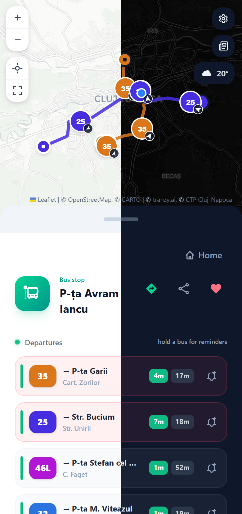<br><sub>Default</sub></td>
    <td align="center">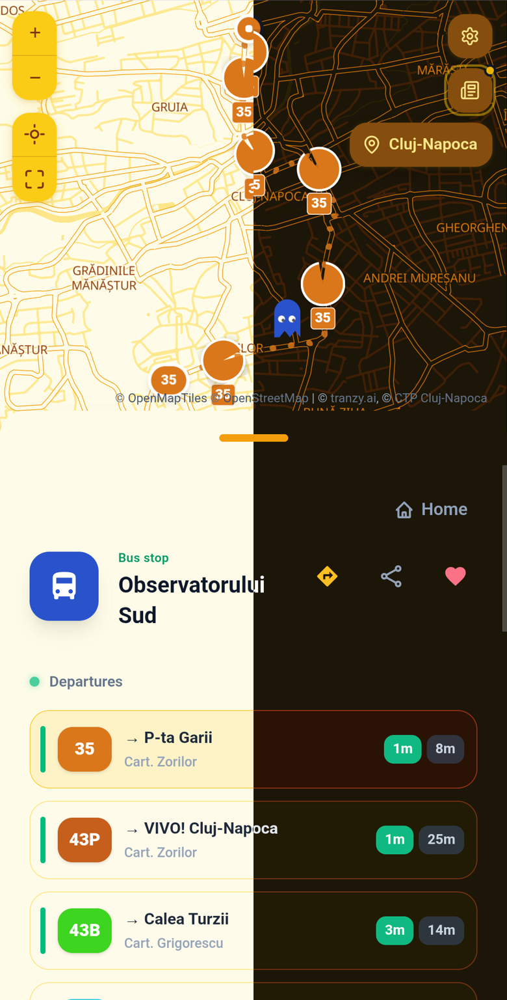<br><sub>Arcade</sub></td>
  </tr>
  <tr>
    <td align="center">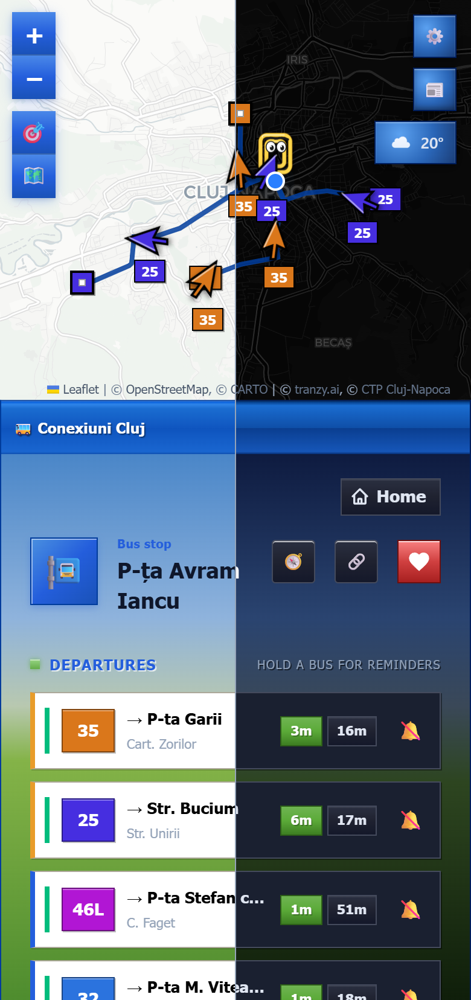<br><sub>Legacy Blue</sub></td>
    <td align="center">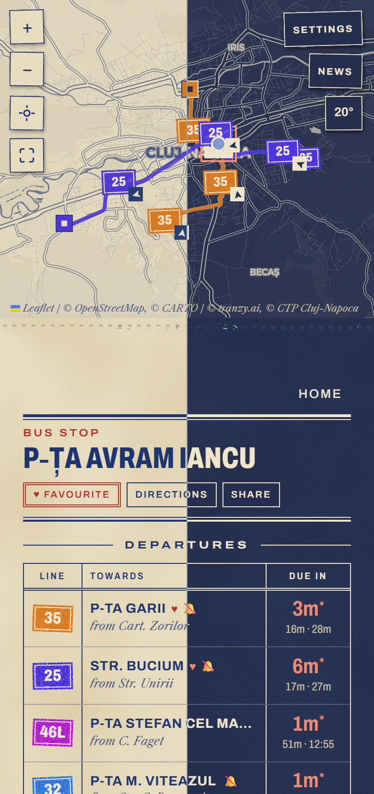<br><sub>Paper</sub></td>
  </tr>
</table>

### On a watch

It runs in a smartwatch browser too, with a simplified layout: favorites, departures, a line's stops and the live map. Scan the code from Settings to bring your favorites over.

<p align="center">
  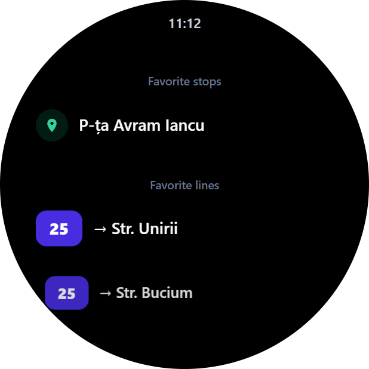
  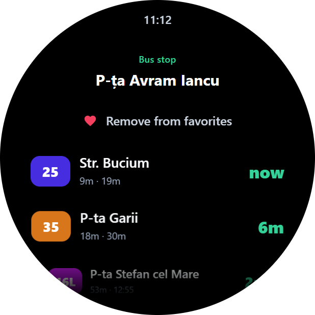
  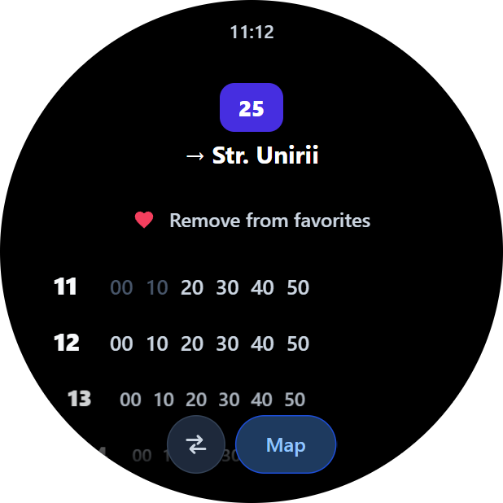
  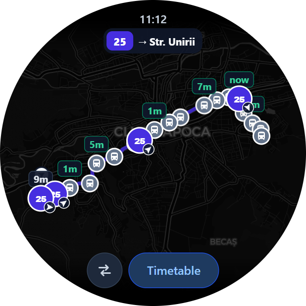
</p>

### On a Playdate

There's a [Playdate companion](https://github.com/bmarian/conexiuni-cluj-playdate) too. It syncs once over Wi-Fi, then stops, routes and timetables work offline.

<p align="center">
  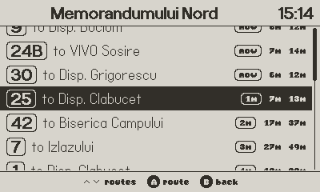
  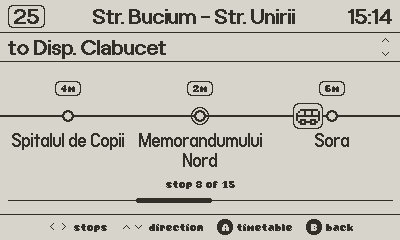
  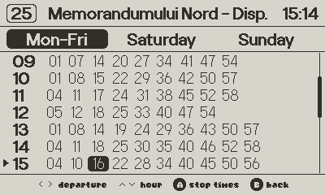
</p>

---

## Running it yourself

You'll need Node 22.12+, Go 1.26+, and a [Tranzy](https://tranzy.ai/) API key.

Put your keys in a `keys.env` next to this README.

```bash
TRANZY_API_KEY=your_tranzy_key
CARTO_KEY=your_carto_key
```

Then the backend and the frontend, each in its own terminal:

```bash
cd backend
go run .
```

```bash
cd frontend
npm install
npm run dev
```

The backend listens on `:6698` and the dev server proxies `/api` to it. Everything else has a default in [`.env`](.env).

**The network bundle** (`/api/network`) is every line with its timetable, stop sequence and learned travel times for each hour of each kind of day, plus every stop. Every client builds stop pages, line pages and timetables from it; there are no per-stop or per-line endpoints. `/api/network/version` tells it when the lines changed. The learned travel times are read once per quarter hour, so those answers hold still between refreshes. **Arrivals** come from `/api/live`: the server snaps every bus once per poll, predicts its arrival at each downstream stop, follows it onto its next trip at a through-running terminus and merges the result with the timetable into final rows per trip and stop. Subscribe by `stop_ids` and `trip_ids` for an SSE stream (a snapshot, then only the rows and buses that changed, gzipped), or add `once=1` for a single JSON answer. Shapes come as encoded polylines with `/api/shapes?format=polyline`. Older consumers: [docs/migration-playdate.md](docs/migration-playdate.md) and [docs/migration-embedded.md](docs/migration-embedded.md).

**Push notifications** need a VAPID key pair in `keys.env` (`VAPID_PUBLIC_KEY`, `VAPID_PRIVATE_KEY`, and `VAPID_SUBJECT` as a contact email or URL). Without it the server runs with push turned off.

**The route planner** runs inside the Go server. It reads the walkable streets around the stops from `backend/services/osm/romania-latest.osm.pbf`, which [`update.sh`](update.sh) downloads from Geofabrik (`--update-pbf` refreshes it).

**Production** is `npm run build` in `frontend/`, which writes to `backend/dist/`, and the Go server serves it directly. `update.sh` is what I deploy with.

## Credits

| Source                                                       | Used for                                                                                   |
| ------------------------------------------------------------ | ------------------------------------------------------------------------------------------ |
| [Tranzy.ai](https://tranzy.ai/)                              | Live GPS positions and GTFS data for CTP Cluj-Napoca                                       |
| [CTP Cluj-Napoca](https://www.ctpcj.ro/)                     | Official timetables                                                                        |
| [Open-Meteo](https://open-meteo.com/)                        | Weather data                                                                               |
| [OpenStreetMap](https://www.openstreetmap.org/) contributors | Map data, © OpenStreetMap contributors, [ODbL](https://opendatacommons.org/licenses/odbl/) |
| [CARTO](https://carto.com/)                                  | Map tiles                                                                                  |
| [Nominatim](https://nominatim.org/)                          | Address search                                                                             |
