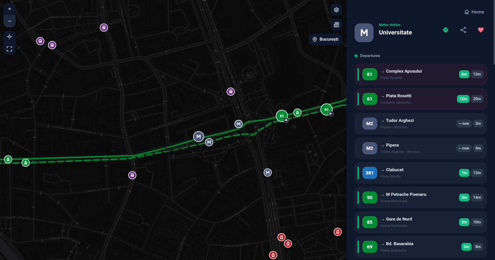
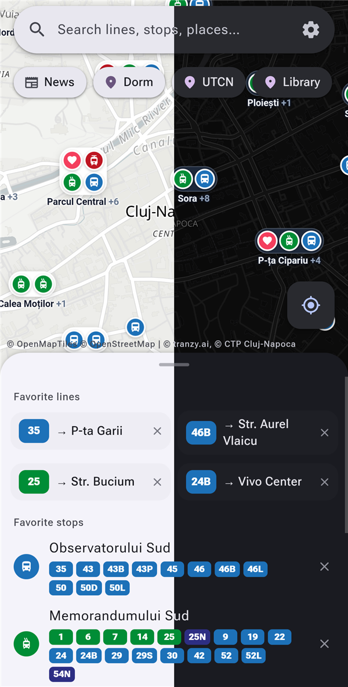
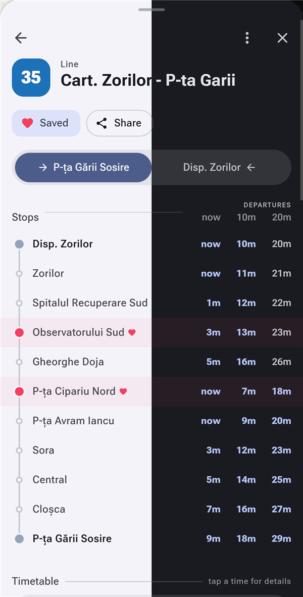
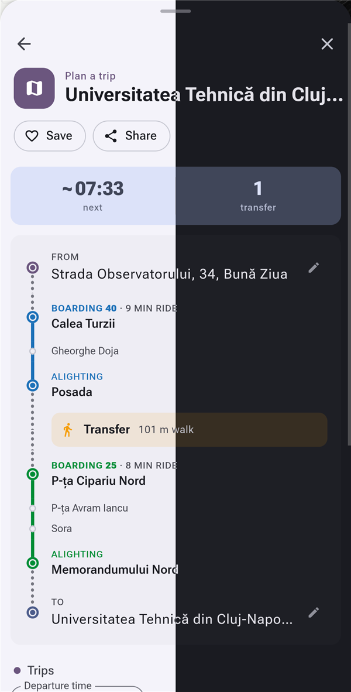
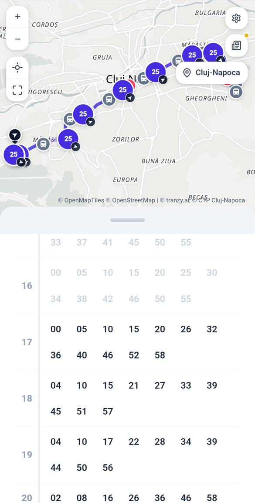

# Ce autobuz iau?

A live bus, tram and trolleybus tracker for Romanian cities. I ride CTP every day and got tired of the official site, so I built the one I actually wanted to use.

**[ceautobuziau.ro](https://ceautobuziau.ro)** (formerly Conexiuni Cluj)



## What it does

- Live buses, trams and trolleybuses on the map
- Departures for any stop. Tracked buses get a live countdown, the rest show approximate times
- Timetables get better on their own, the server watches buses and learns how long each stretch really takes
- Full timetables for every line, from the operator or calculated from live feeds
- A route planner: leave now, leave at, arrive by, or the last one today
- Favorite stops, places and lines
- Operator news, and the changes to the lines you follow
- Installable as an app with offline support after the first visit, the whole network is downloaded once (about 180 KB for Cluj)
- Move your favorites and settings to another phone, by scanning a QR
- Support from hardware keyboards too

<p align="center">
  
  
  
  
</p>

There's an [Android app](https://github.com/bmarian/conexiuni-cluj-mobile), a [Wear OS app](https://github.com/bmarian/conexiuni-cluj-wearos) and a [Playdate app](https://github.com/bmarian/conexiuni-cluj-playdate) too.

## Cities

| City        | Transit company                                                                               | Buses      | Data from                                                                                                                                                         |
| ----------- | --------------------------------------------------------------------------------------------- | ---------- | ----------------------------------------------------------------------------------------------------------------------------------------------------------------- |
| București   | [STB](https://www.stbsa.ro/), [Metrorex](https://www.metrorex.ro/)                            | Live       | [TPBI](https://tpbi.ro/): lines, timetables, live positions and news                                                                                              |
| Cluj-Napoca | [CTP Cluj-Napoca](https://ctpcj.ro/)                                                          | Live       | [Tranzy.ai](https://tranzy.ai/) for lines, stops and live positions, CTP for timetables and news                                                                  |
| Constanța   | [CT BUS](https://www.ctbus.ro/)                                                               | Live       | [Tranzy.ai](https://tranzy.ai/), timetables from [gtfs.ro](https://gtfs.ro/), news from CT BUS                                                                    |
| Craiova     | [RAT Craiova](https://ratcraiova.ro/)                                                         | Live       | RAT Craiova's journey planner by Modeshift: lines, timetables and live positions                                                                                  |
| Iași        | [CTP Iași](https://www.sctpiasi.ro/)                                                          | Live       | [Tranzy.ai](https://tranzy.ai/), timetables from [gtfs.ro](https://gtfs.ro/), news from CTP Iași                                                                  |
| Oradea      | [OTL](https://www.otl.ro/)                                                                    | Live       | [Tranzy.ai](https://tranzy.ai/), timetables from [gtfs.ro](https://gtfs.ro/), news from OTL                                                                       |
| Ploiești    | [TCE Ploiești](https://tceph.ro/)                                                             | Live       | A [volunteer-made GTFS](https://gtfs.opendev.ro/GTFS-305.zip), live positions from [gtfs.ro](https://gtfs.ro/), news from TCE                                     |
| Suceava     | [TPL Suceava](https://tpl-sv.ro/)                                                             | Live       | A [volunteer-made GTFS](https://gtfs.opendev.ro/GTFS-328.zip), TPL's line pages for the lines it lacks, and the buses on TPL's own live map                       |
| Târgu Mureș | [Transport Local](https://transportlocal.ro/)                                                 | Live       | Transport Local's [GTFS](https://live.transportlocal.ro/gtfs.zip) and the buses on its [live map](https://live.transportlocal.ro/)                                |
| Botoșani    | [Eltrans](https://eltransbt.ro/)                                                              | Timetables | Eltrans's own [routes page](https://eltransbt.ro/trasee): lines, stations and the timetable PDF it links                                                          |
| Sibiu       | [Tursib](https://tursib.ro/)                                                                  | Timetables | Tursib: lines, timetables and news                                                                                                                                |

This is an unofficial app, not affiliated with any of these companies or city halls.

## Credits

| Source                                                                             | Used for                                                                                                                                                         |
| ---------------------------------------------------------------------------------- | ---------------------------------------------------------------------------------------------------------------------------------------------------------------- |
| [OpenStreetMap](https://www.openstreetmap.org/copyright) contributors              | Map data, walking routes and place search, © OpenStreetMap contributors, [ODbL](https://opendatacommons.org/licenses/odbl/). The extract comes from [Geofabrik](https://www.geofabrik.de/) |
| [OpenFreeMap](https://openfreemap.org/), [OpenMapTiles](https://openmaptiles.org/) | Map tiles                                                                                                                                                        |
| [MapLibre](https://maplibre.org/)                                                  | The map                                                                                                                                                          |

---

## Running it yourself

You'll need Node 20.19+ or 22.12+, Go 1.26+, and a [Tranzy](https://tranzy.ai/) API key. Put it in a `keys.env` next to this README; in development every Tranzy city uses it, and without it they are left out.

```bash
TRANZY_API_KEY_DEVELOPMENT=your_tranzy_key
```

The route planner, place search and station names read the OpenStreetMap extract for Romania (about 330 MB):

```bash
curl -o backend/services/osm/romania-latest.osm.pbf https://download.geofabrik.de/europe/romania-latest.osm.pbf
```

Then the backend and the frontend, each in its own terminal:

```bash
cd backend
go run .
```

```bash
cd frontend
npm install
npm run dev
```

The backend listens on `:6698` and the dev server proxies `/api` to it. Everything else has a default in [`.env`](.env).

<details>
<summary><b>Keys and cities</b></summary>

<br>

București, Craiova, Ploiești, Târgu Mureș, Suceava, Botoșani and Sibiu need no key. In production each Tranzy city has its own, `TRANZY_API_KEY_{CITY}`. An optional second key, `TRANZY_API_KEY_{CITY}_LEARNING` (`TRANZY_API_KEY_DEVELOPMENT_LEARNING` in development), keeps the server learning travel times while nobody is watching, without eating into the live quota. `VEHICLE_LEARNING_ENABLED_{CITY}` in `.env` turns that learning off for one city.

Each city keeps its own SQLite database in `db/{city}.db` and its history in `archive/{city}.db`. Cities listed in `db/disabled-cities.json` are switched off; the admin page switches them on and off while the server runs.

</details>

<details>
<summary><b>How the data reaches the website and the apps</b></summary>

<br>

**The network bundle** (`/api/{city}/network`) is every line with its timetable, stop sequence and learned travel times for each hour of each kind of day, plus every stop and the station it belongs to. Every client builds stop pages, line pages and timetables from it; there are no per-stop or per-line endpoints. `/api/{city}/network/version` tells it when the lines changed. The learned travel times are read once per quarter hour, so those answers hold still between refreshes.

**Arrivals** come from `/api/{city}/live`: the server snaps every bus once per poll, predicts its arrival at each downstream stop, follows it onto its next trip at a through-running terminus and merges the result with the timetable into final rows per trip and stop. Subscribe by `stop_ids` and `trip_ids` for an SSE stream (a snapshot, then only the rows and buses that changed, gzipped), or add `once=1` for a single JSON answer.

**Everything else:** `/api/cities` lists the cities that are on, `/api/{city}/plan` plans a trip, `/api/{city}/places` searches addresses and places, `/api/{city}/areas` names the towns and districts the zoomed-out map shows, `/api/{city}/updates` merges operator news with line changes, `/api/{city}/shapes?format=polyline` gives the line shapes, and `/api/sync` keeps a person's devices in step, end-to-end encrypted (`backend/devicesync/protocol.md`).

</details>

<details>
<summary><b>Adding a city</b></summary>

<br>

A city is a folder under [`backend/cities/`](backend/cities) with a `city.go` that names it, its operator and its feeds, plus one line in `allCities` in [`backend/cities.go`](backend/cities.go). The shared readers cover Tranzy, GTFS zips, GTFS-realtime and RSS news; anything a city publishes in its own format gets a reader in its folder, like Cluj's CSV timetables or Botoșani's PDF.

</details>

<details>
<summary><b>Production</b></summary>

<br>

`npm run build` in `frontend/` writes to `backend/dist/`, and the Go server serves it directly. With `ENV=production` the server also needs `ADMIN_TOKEN` and `LOG_IP_HASH_SALT` in `keys.env`.

[`update.sh`](update.sh) is what I deploy with: it pulls, builds both halves, downloads the OpenStreetMap extract if it's missing and restarts the service. `--update-pbf` refreshes the extract, `--bust-cache` makes every source download again, and `--delete-db` / `--delete-logs` start from scratch.

</details>
